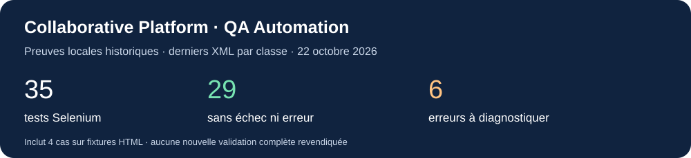
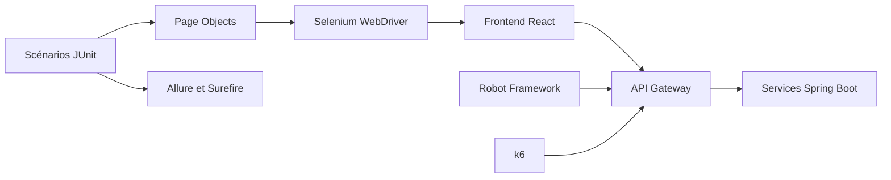
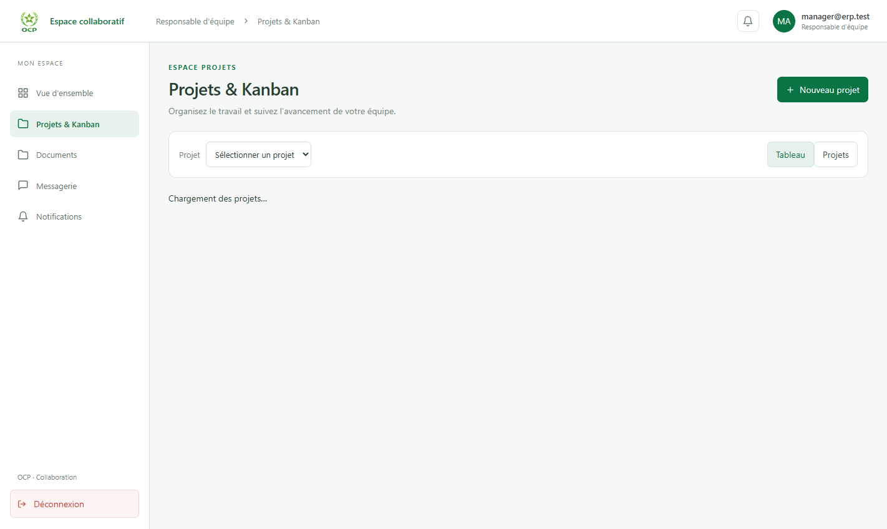

# Collaborative Platform — QA Automation

**Automatisation Web, API et performance pour une plateforme collaborative React / Spring Boot.**

Ce dépôt présente une démarche QA : conception de scénarios, automatisation Selenium avec Page Objects, contrôles API JWT, préparation de scénarios k6, analyse des erreurs et publication de preuves d'exécution.




## Pour découvrir le projet

| À consulter | Ce que cela montre |
| --- | --- |
| [Résultats et limites](docs/results/README.md) | Compteurs vérifiés, erreurs conservées et périmètre des preuves |
| [Exemple de Page Object](src/test/java/com/qa/pages/UsersPage.java) | Locators, attentes et actions réutilisables |
| [Exemple de test métier](src/test/java/com/qa/tests/users/UserCreationTest.java) | Assertions de création et de persistance après rechargement |
| [Tests des helpers UI](src/test/java/com/qa/tests/contracts/PageObjectRegressionTest.java) | Régressions isolées sur fixtures HTML |
| [Plan de test](TEST_PLAN.md) / [Traçabilité](TRACEABILITY_MATRIX.md) | Organisation de la couverture et lien avec les exigences |
| [Analyse des anomalies](BUG_REPORTS.md) | Distinction entre constats de code et reproductions à l'exécution |

## Application testée

L'application cible propose authentification, administration des utilisateurs, rôles et permissions, départements, équipes et projets Kanban. Elle utilise un frontend React / TypeScript et des services Spring Boot accessibles via une passerelle API.

Ce dépôt contient **le framework QA**, pas le code applicatif. L'environnement cible doit être démarré séparément. Les adresses locales par défaut sont `http://localhost:5173` pour le frontend et `http://localhost:9000` pour la passerelle.

## Travail présenté

- Structuration du framework Java 17 / Maven avec Selenium, JUnit 5 et AssertJ.
- Conception de Page Objects et d'attentes explicites pour les interfaces métier.
- Scénarios de connexion, validation des formulaires, navigation et contrôle d'accès.
- Tests de gestion des utilisateurs, rôles, départements, équipes et Kanban.
- Captures d'échec et intégration Allure pour faciliter le diagnostic.
- Deux contrôles API JWT avec Robot Framework et RequestsLibrary.
- Scénarios k6 smoke, charge et stress sur la lecture des projets.
- Garde-fous pour les données QA et nettoyage des seules fixtures créées.
- Workflows GitHub Actions et documentation de la stratégie de test.

## Résultats disponibles

| Preuve | Résultat | Interprétation |
| --- | --- | --- |
| Selenium / JUnit, XML locaux du 22 octobre 2026 | **35 tests : 29 sans erreur, 6 erreurs, 0 ignoré** | Somme des derniers rapports par classe ; pas nécessairement une exécution unique |
| Fixtures HTML Page Object, incluses dans les 35 | **4 réussites** | Validation des helpers UI, sans appel aux API métier |
| Robot Framework, rapport du 21 octobre 2026 | **2 réussites, 0 échec** | Connexion JWT et rejet des identifiants invalides ; assertion négative à renforcer |
| Tests Node du validateur k6 | **3 réussites** | Validation des règles de sélection de cible ; pas un benchmark |
| Charge et stress k6 | Scénarios présents | Aucun résultat de performance publié ou capacité revendiquée |

Les six erreurs Selenium concernent Kanban, permissions, création, modification, suppression et validation d'utilisateurs. Les classes d'erreurs et le détail par suite sont publiés dans [la synthèse des résultats](docs/results/README.md). Ces preuves sont historiques et ne garantissent pas l'état actuel de l'application.

## Architecture de test



```text
Collaborative-Platform-QA/
├── src/test/java/com/qa/
│   ├── core/              # Configuration, navigateur, capture d'échec
│   ├── pages/             # Page Objects
│   └── tests/             # Scénarios et régressions des helpers
├── robot-framework/       # Authentification API JWT
├── performance/k6/        # Smoke, charge, stress et garde-fous
├── .github/workflows/     # Selenium, Robot et k6
├── config/                # Modèle des identifiants de fixtures
├── docs/assets/           # Visuels sélectionnés pour publication
├── docs/results/          # Synthèses expurgées JSON, CSV, HTML
├── .env.example           # Configuration sans identifiants réels
├── run-qa.ps1             # Lanceur local PowerShell
└── pom.xml
```

## Aperçu de l'interface testée



Capture historique issue des artefacts Selenium : espace projets/Kanban avec un compte synthétique et chargement des projets en cours. Elle illustre l'interface observée pendant le diagnostic, **pas la réussite d'un parcours Kanban complet**.

## Démarrage

### Prérequis

- JDK 17 et Maven 3.x.
- Chrome ou Firefox ; Selenium Manager gère le pilote.
- Python 3.12+ pour Robot Framework.
- Node.js pour les tests du validateur k6.
- k6 pour les scénarios natifs, ou Docker Desktop pour le lanceur k6.
- Application cible disponible, comptes de test et base QA isolée pour les écritures.

### Configuration

```powershell
Copy-Item .env.example .env
```

Compléter `.env` avec les comptes dédiés. Les variables d'environnement priment sur le fichier local. `QA_VALID_LANDING_PATH` doit correspondre au rôle du compte : `/dashboard`, `/director`, `/manager` ou `/employee`.

`QA_TEST_DATA_ISOLATED=true` autorise les tests d'écriture ; ce drapeau ne vérifie pas lui-même la base. Laisser `false` tant que l'isolation n'est pas confirmée.

### Selenium

```powershell
mvn test-compile
# Régressions des Page Objects : navigateur requis, application non requise
mvn "-Dtest=PageObjectRegressionTest" test
# Contrôles frontend : application accessible
mvn "-Dtest=EmptyLoginValidationTest,ProtectedRouteTest" test
# Suite complète : comptes et services requis ; écritures soumises au garde-fou
mvn test
```

### Robot Framework

```powershell
python -m venv .venv
.\.venv\Scripts\Activate.ps1
python -m pip install -r robot-framework/requirements.txt
python -m robot --outputdir reports/robot robot-framework/api
```

La suite utilise `QA_API_BASE_URL` et les comptes `QA_VALID_*`, ou les variables dédiées `QA_API_EMAIL` / `QA_API_PASSWORD`.

### k6

```powershell
# Tests locaux des règles de cible : aucun appel API
node --test performance/k6/lib/config.test.cjs
# Smoke natif : cible QA et token éventuel configurés dans le terminal
k6 run --summary-export performance/results/smoke.json performance/k6/smoke/projects-read.js
```

Le scénario k6 requiert `K6_ALLOW_LOCAL=true` pour une cible loopback, ou `K6_ALLOW_TEST_ENVIRONMENT=true` pour une cible QA distante explicitement autorisée. `K6_ACCESS_TOKEN` fournit le bearer token si nécessaire. Créer le dossier `performance/results` avant l'export s'il n'existe pas. Les scénarios de charge/stress nécessitent une autorisation et un environnement adapté.

### Rapports locaux

```powershell
allure serve target/allure-results
```

Allure CLI est un prérequis séparé. Surefire écrit dans `target/surefire-reports`. Les rapports bruts et captures restent ignorés par Git ; seules des synthèses et images inspectées sont sélectionnées pour publication.

## GitHub Actions

Trois workflows existent : **Selenium UI**, **Robot API**, **k6 Performance**. Ils ciblent un environnement QA déjà accessible ; ils ne déploient pas l'application.

Selenium et Robot peuvent être déclenchés manuellement ou par pull request sur les fichiers concernés. k6 est manuel. Configurer les variables, secrets et protections de l'environnement `qa` avant exécution.

**État : configuration présente, aucune exécution GitHub réussie revendiquée.** Le workflow Selenium lance actuellement toute la suite sans fournir les comptes administrateur/non-administrateur : son paramétrage ou sa sélection de tests doit être complété. Les tests d'écriture sont ignorés sans autorisation d'isolation. Le workflow k6 ne configure pas encore l'export des fichiers qu'il tente de joindre comme artefacts.

## Limites et prochaines améliorations

1. Diagnostiquer les six erreurs présentes dans les rapports Selenium.
2. Renforcer le scénario API négatif pour refuser les réponses 5xx.
3. Propager systématiquement les codes d'échec Selenium et Robot dans `run-qa.ps1 all`.
4. Compléter les secrets et la séparation des suites CI avant d'en faire un contrôle bloquant.
5. Ajouter un export exploitable des résultats k6 et définir le rythme de charge attendu.
6. Actualiser les documents historiques après une nouvelle campagne sur une version applicative identifiée.

Les documents d'audit et certaines anciennes instructions décrivent des observations antérieures ; leur état doit être revérifié sur la version applicative testée. La synthèse publiée conserve les échecs et distingue les constats de code des preuves d'exécution.

## Documentation

- [Plan de test](TEST_PLAN.md)
- [Cas de test](TEST_CASES.md)
- [Matrice de traçabilité](TRACEABILITY_MATRIX.md)
- [Guide détaillé d'exécution — historique à recouper avec ce README](TEST_EXECUTION.md)
- [Anomalies et constats d'intégration](BUG_REPORTS.md)
- [Audit technique](docs/QA_AUDIT.md)
- [Réparations Selenium](docs/SELENIUM_REPAIR.md)
- [Résultats publiés](docs/results/README.md)

## Auteur

**Fatima Bousmiti — QA Automation**

[Profil GitHub](https://github.com/FATIMA-BOUSMITI)

Ce dépôt présente le travail d'automatisation et d'analyse QA. Le code de l'application cible n'est pas inclus et son développement n'est pas revendiqué ici.
