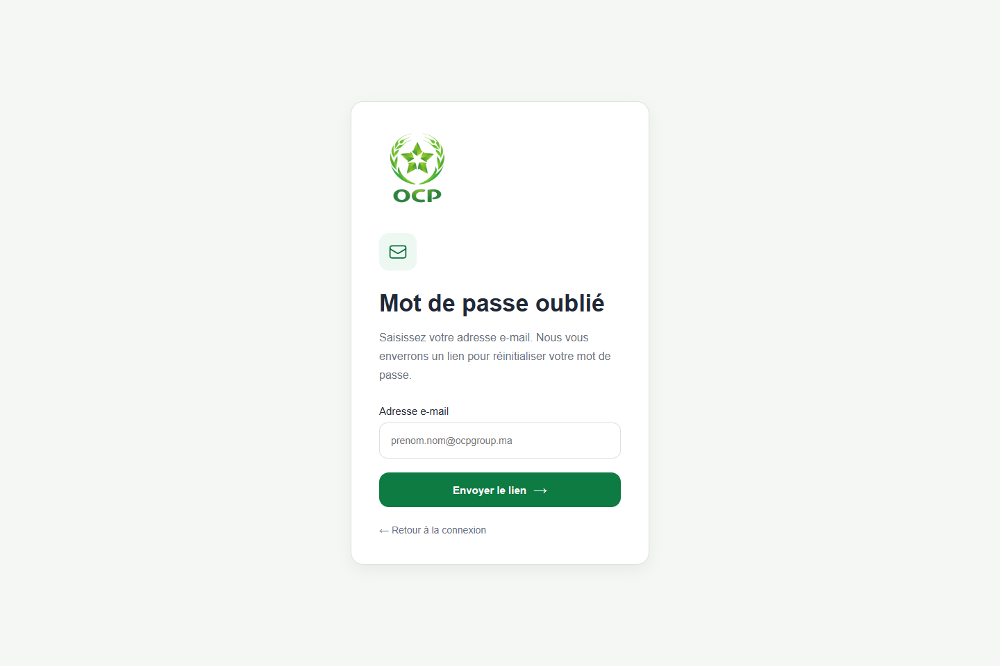

# Démonstration de la plateforme collaborative

**6 captures réelles du frontend, avec observation des réponses backend.**

Captures : `2026-10-28T23:12:29.690194+00:00`. Navigateur Chrome automatisé, viewport 1440 × 960. La démonstration utilise le code frontend local dans `Ger` et les JAR Spring Boot déjà compilés. Docker Desktop n'était pas disponible : les services ont été lancés nativement pour cette session.

- [Parcours visuel interactif](index.html) : télécharger ou cloner le dépôt puis ouvrir le fichier ; GitHub affiche le code HTML, pas la galerie exécutée.
- [Manifeste des captures et statuts HTTP](manifest.json).
- [Résultats des tests automatisés](../results/README.md) : preuves distinctes de cette démonstration.

## Ce qui a été démontré

- Affichage des formulaires publics et validation des champs vides.
- Authentification réelle du compte QA manager : réponse de connexion 200, puis lecture du profil 200.
- Navigation vers l'espace projets/Kanban après une première connexion manager réussie.
- Affichage du tableau de bord manager.


Les captures sont obtenues directement dans le navigateur. Aucune réponse API, session authentifiée ou donnée de projet n'a été fabriquée. Les informations personnelles sont masquées par le moteur de capture ; les erreurs applicatives restent visibles.

## Parcours en images

### 1. Authentification

L'écran de connexion réel du frontend. Les champs sont vides ; aucun compte ni mot de passe n'est publié.


### 2. Validation des champs obligatoires

Soumission du formulaire vide : les messages de champs obligatoires apparaissent. Cette vérification concerne le frontend, pas un appel de connexion réussi.


### 3. Mot de passe oublié

Le formulaire de récupération est affiché. Aucun formulaire n'a été envoyé : cette capture ne valide pas la livraison d'un e-mail.



### 4. Lien de réinitialisation absent

Sans token, l'application affiche un lien invalide ou incomplet. Aucun mot de passe n'a été modifié.


### 5. Tableau de bord manager

Tableau de bord obtenu après une vraie connexion du compte QA manager. Les erreurs éventuellement visibles sont conservées ; une page affichée ne prouve pas la réussite de tous ses appels API.


### 6. Projets et Kanban

Espace projets atteint après authentification réelle. L'appel GET /api/projects renvoie HTTP 500 dans cet environnement : la bannière d'erreur est conservée, aucun tableau rempli n'est simulé.


## Backend : réponses observées

Ces statuts proviennent des réponses réellement reçues par le navigateur pendant les tentatives de capture. Les appels aux modules TypeScript de Vite sont exclus. Les identifiants de ressources sont remplacés par `:id`, sans corps de réponse ni token.

| Route | Statuts observés |
| --- | --- |
| `/api/auth/login` | 401, 200 |
| `/api/notifications/unread-count` | 404 |
| `/api/projects` | 500 |
| `/api/users/auth/:id` | 200, 504 |
| `/api/users/directory` | 200 |
| `/api/users/directory/departments` | 200 |

La route de connexion comporte 401 et 200 car deux comptes QA distincts ont été essayés : refus du compte administrateur configuré, réussite du compte manager. Cette table ne représente pas une campagne de tests API exhaustive.

## Limites constatées

- **Administrateur : HTTP 401.** Les captures des écrans administrateur authentifiés ne sont pas incluses ; aucun compte n'a été créé ni mot de passe réinitialisé pour contourner le refus.
- **Projets : HTTP 500.** La démonstration ne valide pas le chargement ni la persistance des projets.
- **Compteur de notifications : HTTP 404.** Cet appel doit être diagnostiqué séparément.
- **Service de profil : HTTP 504 lors d'une nouvelle connexion.** L'authentification a pu réussir tandis que la récupération du profil expirait. Une première lecture de profil 200 a permis la capture Kanban ; les tentatives ne constituent pas un parcours stable garanti.
- Le service utilisateur utilise le profil local existant, comme dans la configuration Docker locale. Cette session ne valide pas la politique de sécurité de production.
- Les services ont été lancés avec Hibernate `validate`, sans demande de migration de schéma. Les connexions ont pu créer des sessions ou entrées d'audit d'authentification ; aucune écriture métier n'a été soumise.
- La concordance exacte entre les JAR déjà compilés et le dernier commit backend n'est pas établie ici. Les résultats historiques de tests ne sont pas remplacés par ces captures.

## Reproduire les captures

L'application et les services doivent être disponibles. Configurer les comptes QA privés dans `.env`, puis utiliser un environnement Python avec les dépendances de capture :

```powershell
python -m pip install -r tools/demo-requirements.txt
python tools/capture_demo.py --project . --base-url http://127.0.0.1:5173 --skip-admin
```

Google Chrome doit être installé. `--skip-admin` évite la tentative administrateur ; sans cette option, le script essaie également les écrans d'administration avec les comptes configurés. Le script bloque les requêtes API d'écriture, à l'exception des opérations d'authentification. Il génère les PNG et un manifeste privé sous `reports/demo-runtime/` : inspecter les images et le manifeste avant toute nouvelle publication. Il ne démarre ni ne modifie l'application.

La capture automatisée sert à documenter une démonstration. Elle ne remplace pas les assertions et rapports Selenium, Robot ou k6 du projet QA.
